

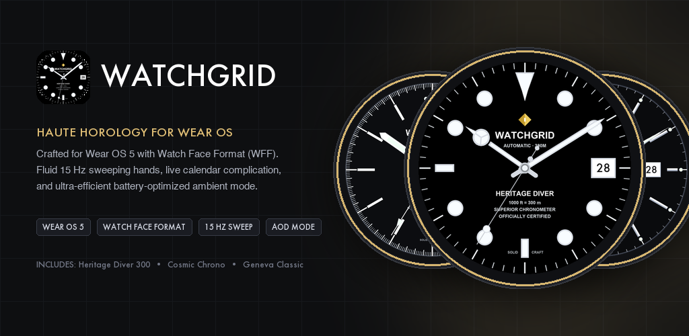

 

# ⌚ WATCHGRID — Haute Horlogerie for Wear OS

**Master-Crafted Mechanical Timepieces · Fluid 15 Hz Sweeping Seconds · Native Wear OS 5 Watch Face Format (WFF)**

[-D4AF37?style=for-the-badge&logo=google-play&logoColor=black)](https://play.google.com/store/apps/details?id=io.solidcrafts.watchgrid)

---

### ✨ Explore the Collection

| [**Heritage Diver 300**](#1-heritage-diver-300-included-free) | [**Cosmic Chrono**](#2-cosmic-chrono) | [**Geneva Classic**](#3-geneva-classic) | [**Celestial Moonphase**](#4-celestial-moonphase) |
| :---: | :---: | :---: | :---: |
| <a href="#1-heritage-diver-300-included-free">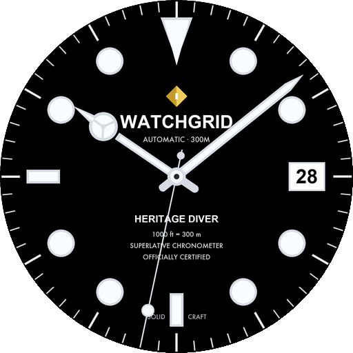</a> | <a href="#2-cosmic-chrono">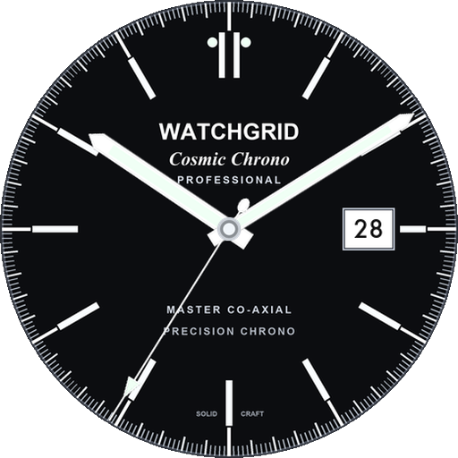</a> | <a href="#3-geneva-classic">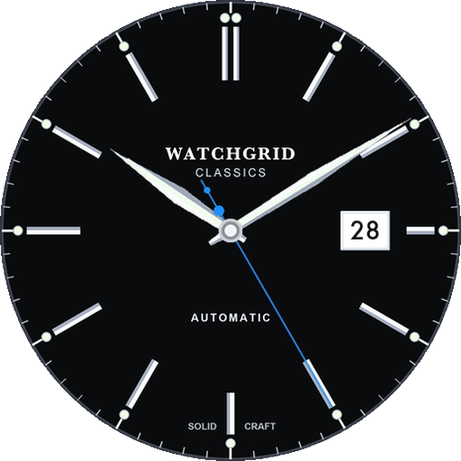</a> | <a href="#4-celestial-moonphase">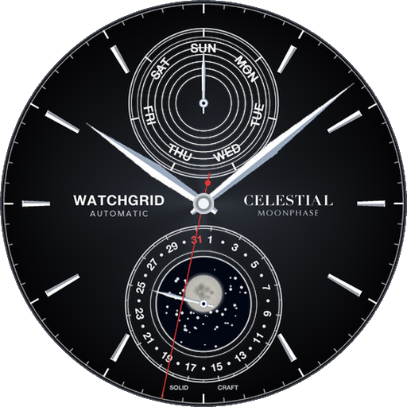</a> |
| `Automatic Diver` | `Space Chronograph` | `Swiss Dress` | `Astronomical Moon` |
|  |  |  |  |
| [**Get on Google Play ↗**](https://play.google.com/store/apps/details?id=io.solidcrafts.watchgrid) | [**Get on Google Play ↗**](https://play.google.com/store/apps/details?id=io.solidcrafts.watchgrid.chrono) | [**Get on Google Play ↗**](https://play.google.com/store/apps/details?id=io.solidcrafts.watchgrid.classic) | [**Get on Google Play ↗**](https://play.google.com/store/apps/details?id=io.solidcrafts.watchgrid.celestial) |

---

## 🏛️ Collection Lineup

### 1. Heritage Diver 300 *(Included Free)*

> **Automatic Professional · 300m / 1000ft**  
> The quintessential luxury maritime diver timepiece. Features an obsidian Maxi dial, bold luminescent geometric hour markers, classic Mercedes hands, and a 3 o'clock cyclops date aperture. Includes the **Watchgrid Companion Phone Studio** for Android.

<table>
  <tr>
    <td align="center" width="28%">
      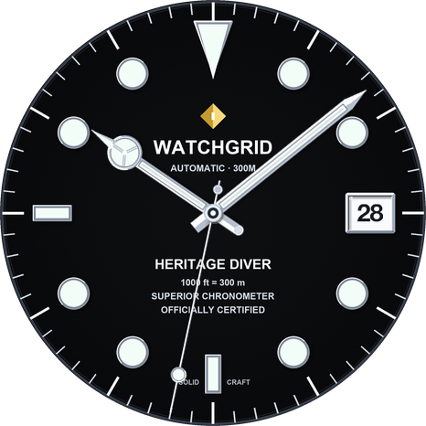 
      <b>Active High-Detail Dial</b>
    </td>
    <td align="center" width="28%">
      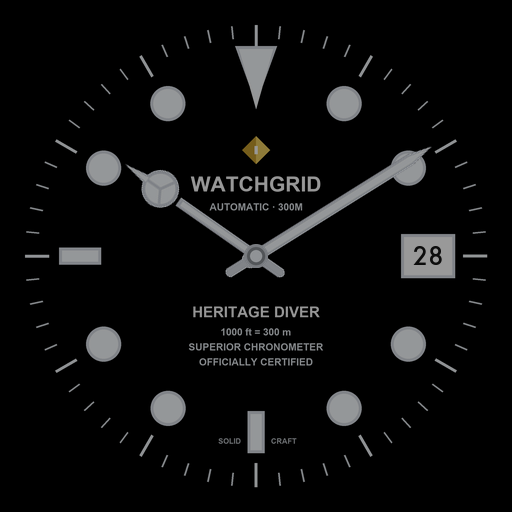 
      <b>Ambient Always-On Lume</b>
    </td>
    <td width="44%">
      <ul>
        <li><b>Case Diameter:</b> 41 mm</li>
        <li><b>Bezel:</b> Unidirectional ceramic 60-min dive bezel</li>
        <li><b>Crystal:</b> Scratch-resistant sapphire with date magnification</li>
        <li><b>Water Resistance:</b> 300 meters / 1,000 feet</li>
        <li><b>Movement:</b> Automatic Mechanical Calibre (28,800 vph / 15 Hz WFF)</li>
        <li><b>Luminescence:</b> High-potency luminescent blue glow</li>
      </ul>
      

        
      

    </td>
  </tr>
</table>

---

### 2. Cosmic Chrono

> **Professional Master Edition · $1.49**  
> Legendary space horology reimagined in a clean luxury layout. Features a matte black tricompax dial with recessed circular snailing subdials, high-visibility luminous baton markers, 3 o'clock date window, and an anodised aluminium Tachymètre bezel ring.

<table>
  <tr>
    <td align="center" width="28%">
      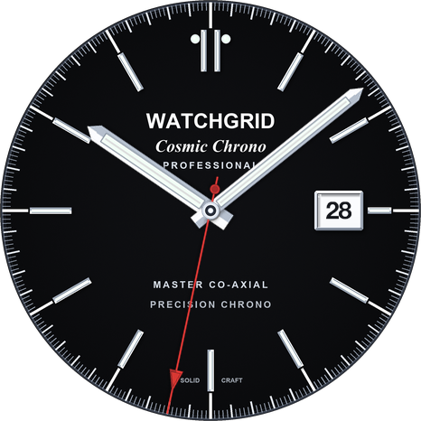 
      <b>Active Tricompax Dial</b>
    </td>
    <td align="center" width="28%">
      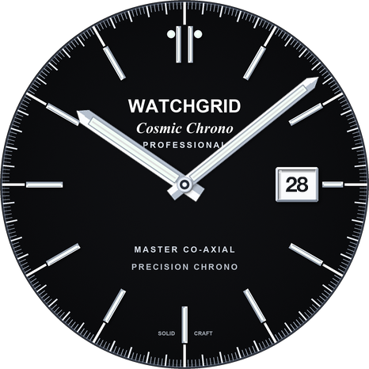 
      <b>Ambient Super-LumiNova</b>
    </td>
    <td width="44%">
      <ul>
        <li><b>Case Diameter:</b> 42 mm</li>
        <li><b>Bezel:</b> Anodised aluminium Tachymètre scale</li>
        <li><b>Crystal:</b> Domed scratch-resistant sapphire crystal</li>
        <li><b>Water Resistance:</b> 50 meters / 167 feet</li>
        <li><b>Movement:</b> Master Co-Axial Precision Chronometer</li>
        <li><b>Luminescence:</b> Super-LumiNova high-legibility green glow</li>
      </ul>
      

        
      

    </td>
  </tr>
</table>

---

### 3. Geneva Classic

> **Classics Automatic Edition · $1.49**  
> Timeless Swiss dress watch artistry with a sleek minimalist aesthetic. Features an onyx black sunburst dial, hand-polished faceted silver indices with luminous tips, razor-sharp dauphine hands, and a framed 3 o'clock date aperture.

<table>
  <tr>
    <td align="center" width="28%">
      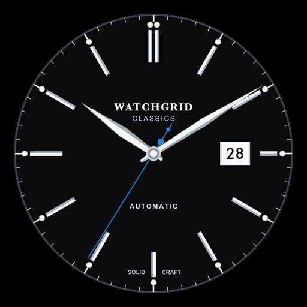 
      <b>Active Dress Dial</b>
    </td>
    <td align="center" width="28%">
      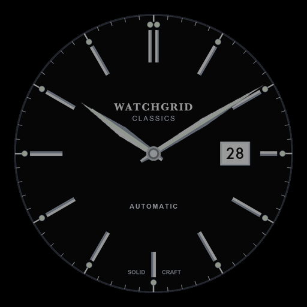 
      <b>Ambient Always-On Mode</b>
    </td>
    <td width="44%">
      <ul>
        <li><b>Case Diameter:</b> 40 mm</li>
        <li><b>Bezel:</b> Polished stainless steel bezel</li>
        <li><b>Crystal:</b> Convex scratch-resistant sapphire crystal</li>
        <li><b>Water Resistance:</b> 50 meters / 165 feet</li>
        <li><b>Movement:</b> High-Beat Automatic Calibre (28,800 vph)</li>
        <li><b>Luminescence:</b> Luminescent markers & faceted dauphine hands</li>
      </ul>
      

        
      

    </td>
  </tr>
</table>

---

### 4. Celestial Moonphase

> **Day-Date Moonphase Automatic · $1.99**  
> Grand astronomical complications meet contemporary Swiss elegance. Features 4 sunburst dégradé dial themes (Onyx Black, Sapphire Blue, Emerald Green, and Sunburst Silver), a 12 o'clock day-of-week pointer subdial, a 6 o'clock date pointer subdial framing a **live 8-phase astronomical moonphase** synchronized to the real lunar cycle, and 3D faceted alpha hands.

<table>
  <tr>
    <td align="center" width="28%">
      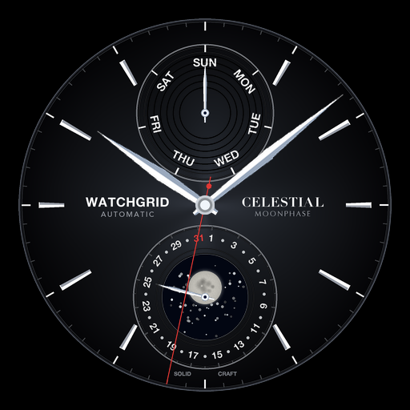 
      <b>Onyx Black Dégradé</b>
    </td>
    <td align="center" width="28%">
      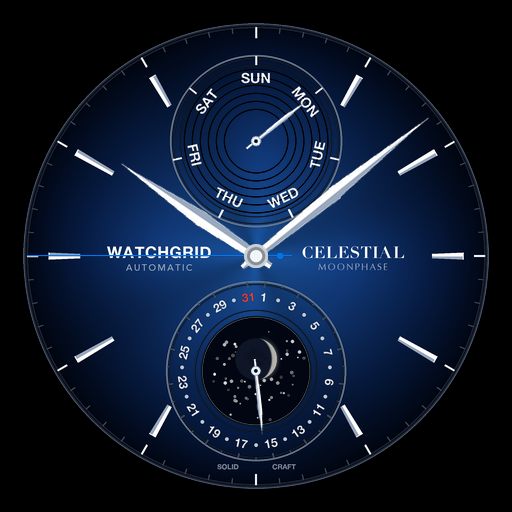 
      <b>Sapphire Blue Theme</b>
    </td>
    <td width="44%">
      <ul>
        <li><b>Case Diameter:</b> 42 mm</li>
        <li><b>Complications:</b> Live 8-Phase Lunar Cycle + Day-of-Week + Pointer Date</li>
        <li><b>Dial Themes:</b> Onyx Black, Sapphire Blue, Emerald Green, Sunburst Silver</li>
        <li><b>Crystal:</b> Domed sapphire crystal with anti-reflective coating</li>
        <li><b>Movement:</b> Baumatic Calibre (120-hour / 5-day power reserve)</li>
        <li><b>Luminescence:</b> Luminous night hands, indices & glowing lunar disc</li>
      </ul>
      

        
      

    </td>
  </tr>
</table>

---

## ⚙️ Technical Excellence

- **Pure Declarative Watch Face Format (WFF)**: Built strictly to Google and Samsung's Wear OS 5 specification (`android:hasCode="false"`), allowing the watch's dedicated low-power co-processor to render animations directly with minimal battery drain.
- **On-Wrist Customization**: Long-press any Watchgrid dial on your smartwatch to customize:
  - **Dial Themes & Finishes** (Rhodium Steel, 18k Yellow Gold, Rose Gold, Flame-Blued Steel)
  - **Second Hand Accents** (Silver, Emerald, Gold, Racing Red, Royal Blue, Ultraman Orange)
  - **Movement Frequency** (`15 Hz` High-Beat Sweep, `1 Hz` Mechanical Beat, or `Two-Hand` Stealth Dress Mode)
  - **4 Ambient Always-On Display (AOD) Modes** (Full Luminous, Subtle Glow, Faint Shadow, or Eco Minimalist)
- **Compatible Smartwatches**: Google Pixel Watch (1, 2, 3), Samsung Galaxy Watch (4, 5, 6, 7, Ultra), Xiaomi Watch 2 / 2 Pro, OnePlus Watch 2 / 2R, TicWatch Pro 5, and all Wear OS 4+ circular smartwatches.

---

  Crafted with precision by <b>Solidcrafts Horology</b> · <a href="catalog.json">Live Catalog JSON</a> · <a href="index.html">Privacy Policy</a>

